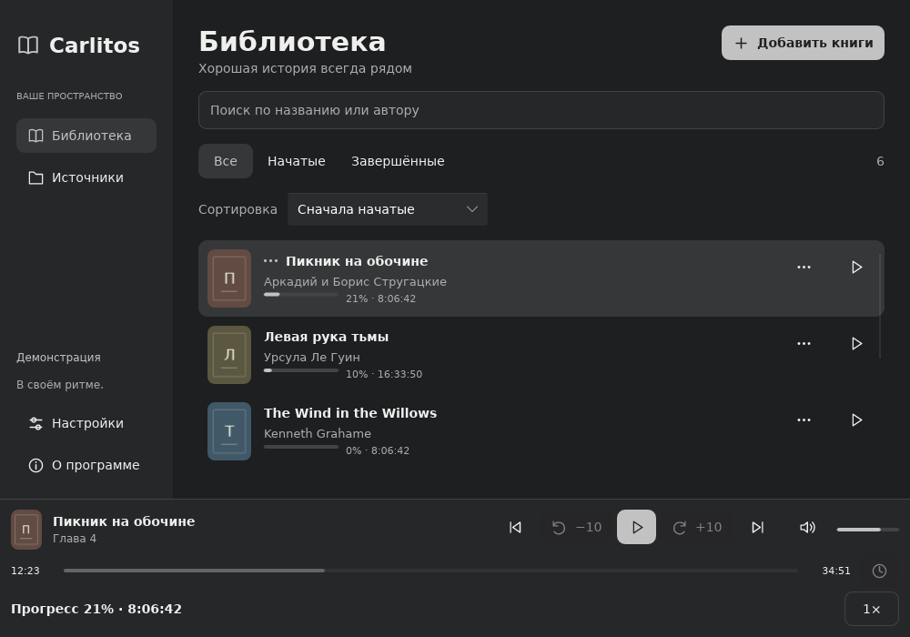
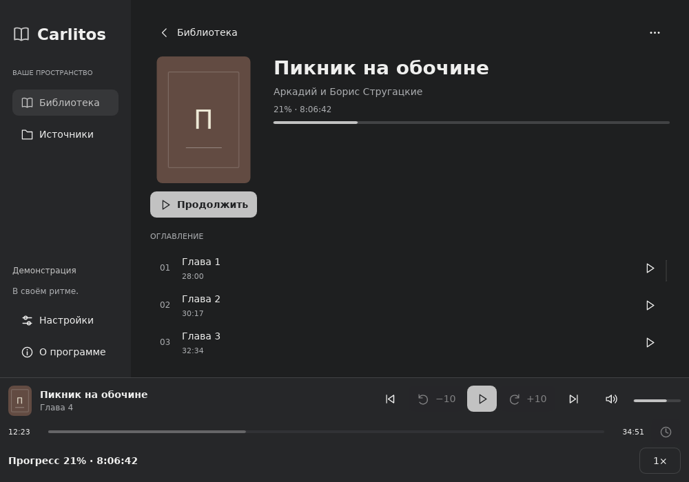
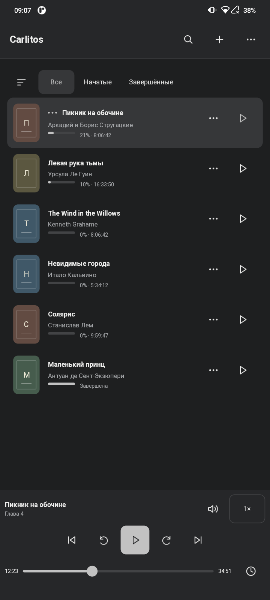
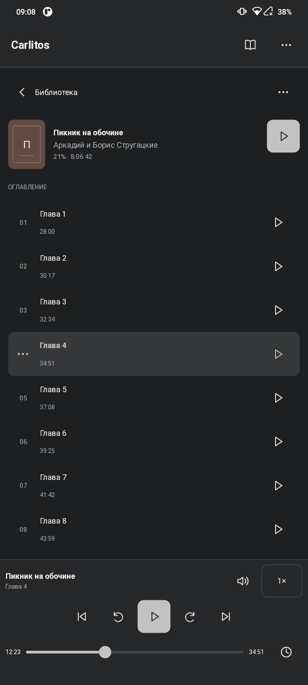

# Carlitos

Плеер локальных аудиокниг для Linux, Windows и Android: библиотека, главы,
сохранение позиции, скорость воспроизведения и пропуск тишины.

[Скачать релиз](https://github.com/mny315/Carlitos/releases/latest): **Windows — Carlitos.exe**,
**Android — ARMv7 / ARM64 / универсальный APK**, **Linux — переносимый архив**.

Сборка на Linux с Nix — через единый `build.sh`:

```sh
./build.sh                 # меню сборки, запуска и групп тестов
./build.sh run             # запуск на Linux
./build.sh linux           # переносимый архив Linux
./build.sh windows         # установщик Windows Carlitos.exe
./build.sh android keygen  # создать локальный ключ Android один раз
./build.sh android         # APK: ARMv7, ARM64 и универсальный
./build.sh all             # релизы для всех трёх платформ
```

[Android](android/README.md) · [Группы тестов](tests/README.md)

Локальная синхронизация прогресса и скорости книги:

1. Подключите устройства к одному роутеру и включите «Настройки → Синхронизация» на обоих.
2. На компьютере нажмите «Показать QR для подключения», на телефоне — «Сканировать QR». Код действует 5 минут и связывает одно устройство. Для устройств без камеры раскройте «Подключение по коду»: там доступны копирование и ввод кода.
3. Оставьте Carlitos работающим на обоих устройствах: позиции обновляются автоматически. После привязки устройства находят друг друга при следующих запусках.

Для ручного подключения нажмите «Показать мой код» и введите **4 цифры**
на другом устройстве. Кнопка справа от кода копирует его в буфер обмена.
Код действует 5 минут, используется один раз и закрывается после 5 неверных
попыток. Он не передаётся по сети: устройства согласуют защищённое соединение
через SPAKE2, затем обмениваются ключами синхронизации.
Если поиск устройств в локальной сети заблокирован, используйте QR: он содержит
адреса подключения. Подключение по 4 цифрам требует обновления Carlitos на обоих
устройствах; QR от старых версий по-прежнему принимаются.
Мобильный интернет сам по себе не соединяет устройства: телефон должен быть
подключён к общей Wi-Fi сети. VPN и брандмауэр должны разрешать локальную связь.

Для ручного обмена нажмите кнопку синхронизации в библиотеке или настройках
**на одном устройстве**. Иконка вращается во время обмена и подготовки книг;
после ручного запуска появляется результат или сообщение об отсутствии связи.
При отключённой синхронизации кнопка в библиотеке скрыта. Устройства отображаются
под системными именами: hostname компьютера и имя телефона из настроек Android.

Для каждой книги применяется последнее изменение, включая перемотку назад,
отметку о завершении и сброс прогресса. На устройствах должны быть точные копии
аудиофайлов; имена файлов и расположение папок могут различаться. При первом
включении приложение вычисляет отпечатки файлов в фоне. Передаётся только
прогресс и скорость, соединение зашифровано, облако и отдельный сервер не нужны.
Скорость запоминается для каждой книги и применяется при её открытии.
Она имеет отдельную отметку изменения: смена скорости не перезаписывает позицию.
Новые версии используют компактные бинарные записи и сверяют контрольные суммы:
если данные совпадают, они повторно не передаются. Со старой версией
автоматически используется прежний формат обмена.

Если более новая позиция приходит для открытой книги, плеер переходит на неё
и остаётся на паузе. Для сравнения изменений используются часы устройств;
включите автоматическую установку времени. Обмен возможен, пока оба устройства
доступны в локальной сети; на Android доступность в фоне зависит от ограничений
системы. Привязки можно удалить в настройках синхронизации.

Скриншоты с демонстрационной библиотекой. Linux:

<p>
  
  
</p>

Android — Redmi 9C NFC, ARM 32 бита:

<p>
  
  
</p>
